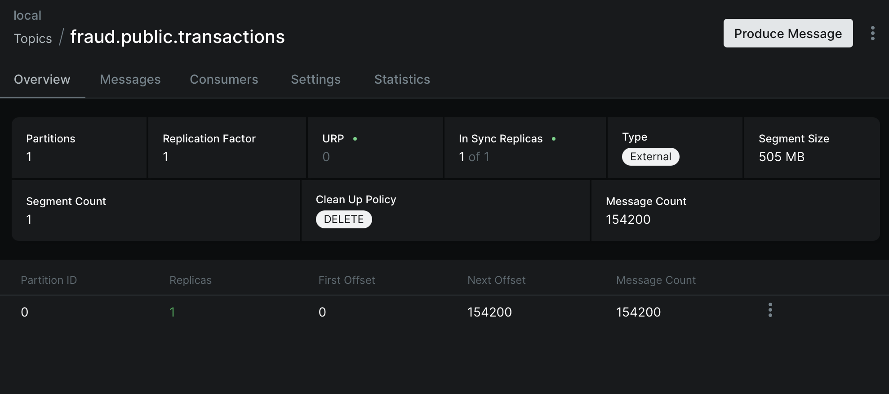
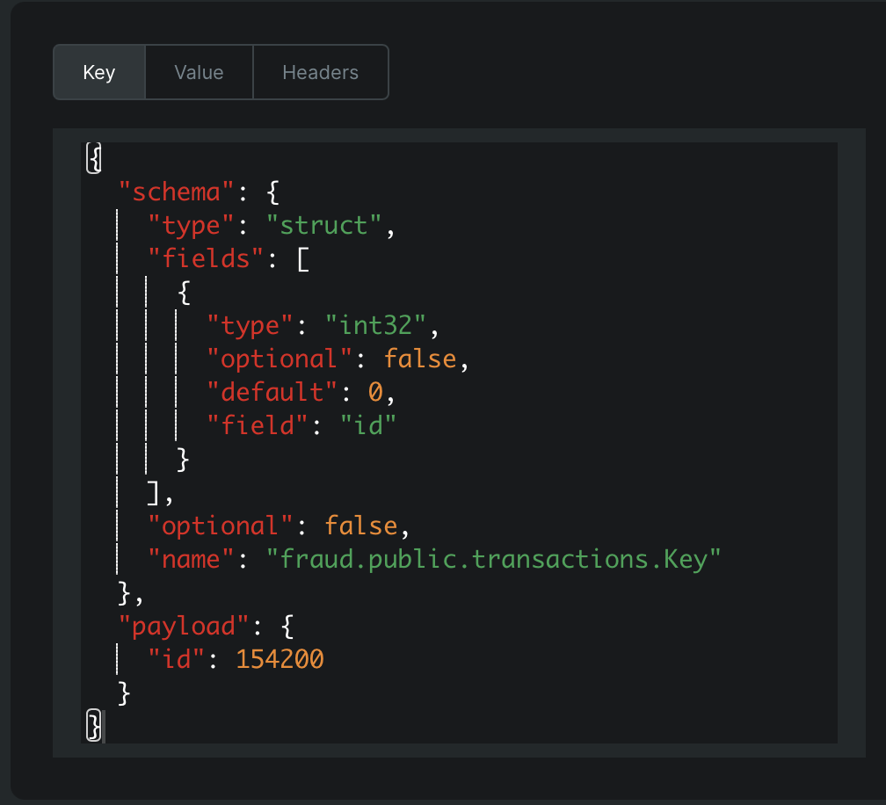
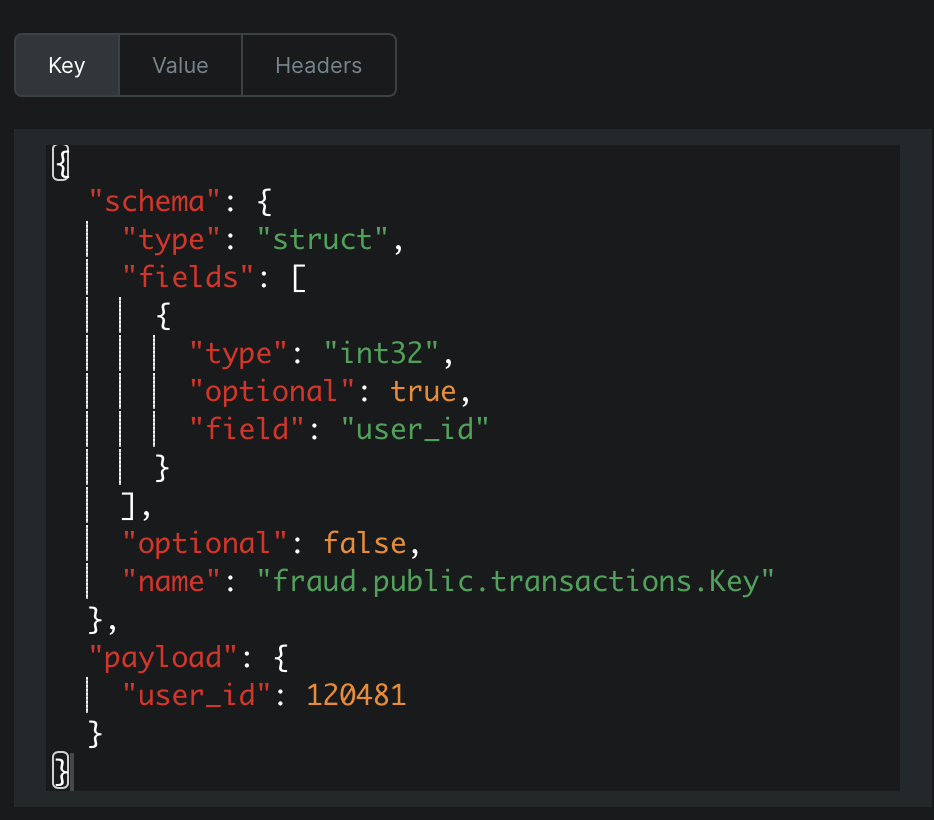

# Exercise 6 — Card Sentinel: real-time fraud detection with CDC

## 1. Decision: how do the payments reach the models?

I would go with option 4, log-based CDC with Debezium. The main reason is that we are not allowed to touch the payment path, and with CDC we don't have to: Debezium just reads the write-ahead log (WAL) that PostgreSQL writes anyway, so there are no code changes and no extra queries on the database (R1). It also gets every committed payment in the right order, so we don't miss payments like the poller in Exercise 5 did, and we can't lose or invent payments like with dual write (R2). The downside is the replication slot: PostgreSQL keeps all the WAL that Debezium hasn't read yet, so if the connector is down for a weekend, the disk can fill up and then the whole database and the payments stop. To catch that early, I would monitor the connector status and how much WAL each slot is holding back (`pg_replication_slots`), with an alert long before the disk is full. If our team owned the payment path, I would use the outbox pattern instead, because then the payment and its event are written in the same transaction and we can design the event ourselves.

## 2. The pipeline in three runs

### Run 1 — Debezium's defaults

**Prediction:** Nobody told Debezium how many partitions to use, so I think the topic gets only 1 partition. Then only one of the three velocity agents gets work, and one agent can't handle 1,000 payments/s alone, so it falls behind and R4 fails. The key shouldn't matter yet, because with one partition this agent sees all payments anyway.

```
R3  frauds caught          2/6  (33%)   FAIL  (>= 90 %)
R3  false alerts           0   PASS  (at most 10 % of the flagged transactions)
R4  alert latency p50/p95  55.1 s / 73.5 s   FAIL  (p95 <= 5 s after the commit)
```



**Why:** The topic really got just 1 partition, and in a consumer group one partition can only be read by one agent, so vel-1 did everything and vel-2 and vel-3 got `assigned partitions []`. vel-1 only managed about 390 payments/s, so its lag grew by about 3 s every 5 s (74 s after two minutes) and the alerts came about a minute late. R3 failed too, but only because the newer frauds were still stuck in the queue, not because of the model.

### Run 2 — 6 partitions

**Prediction:** With 6 partitions every velocity agent gets 2, so all three work and together they should keep up (3 × ~390/s on my laptop), so R4 passes. But the key is still the payment id, so the 12 test payments of a stolen card get spread over all partitions and every agent only sees about 4 of them. The model needs 8, so I think it catches almost nothing and R3 fails.

```
R3  frauds caught          1/6  (17%)   FAIL  (>= 90 %)
R3  false alerts           0   PASS  (at most 10 % of the flagged transactions)
R4  alert latency p50/p95  1.1 s / 1.1 s   PASS  (p95 <= 5 s after the commit)
```

**Why:** All three agents shared the work evenly and the lag stayed at about 1 s, so R4 passed. But because the key is the payment id, `hash(id) mod 6` scatters the thief's 12 payments over all partitions, so each agent only counts about 4 and never reaches 8 (the one catch was luck). Interesting: `out-of-order` went from 0 to 1–2, because Kafka only keeps the order inside one partition, and one cardholder's payments were now on several partitions.

### Run 3 — the cardholder as the key

**Prediction:** Now the key is `user_id`, so all payments of one cardholder go to the same partition and the same agent, in the right order. That agent sees all 12 test payments and alerts at the 8th, so R3 should pass, and the speed stays the same, so R4 too.

```
R3  frauds caught          6/6  (100%)   PASS  (>= 90 %)
R3  false alerts           0   PASS  (at most 10 % of the flagged transactions)
R4  alert latency p50/p95  0.9 s / 1.1 s   PASS  (p95 <= 5 s after the commit)
```

| Runs 1 and 2: key = payment id | Run 3: key = cardholder |
|---|---|
|  |  |

**Why:** `hash(user_id) mod 6` always gives the same partition for one cardholder, so one agent saw the whole attack and caught all 6 frauds, with `out-of-order` back at 0 and still about 1 s lag. You can also see that every cardholder now lives in only one agent: together the three velocity agents keep about 71,000 cardholders, the same as the anomaly agent alone, compared to about 101,000 in Run 2, where cardholders were split over several agents.

## 3. Closing answer: defaults are decisions

Debezium picked 1 partition and the primary key as the key. That's fine if you only want to copy a table, but not for a stateful model that has to scale. With 1 partition in production, the alerts would come minutes late, so a stolen card wouldn't get blocked in time, and adding more agents wouldn't help. With 6 partitions but the wrong key it's even worse, because everything looks fine (low lag, all agents busy) but almost no card testing gets caught, and there's no error anywhere, so you would only find out weeks later from the chargebacks. The team could have noticed by checking the topic (partitions and message key) before going live, by watching consumer lag and agents without partitions, and by testing with known frauds like the scoreboard does.

